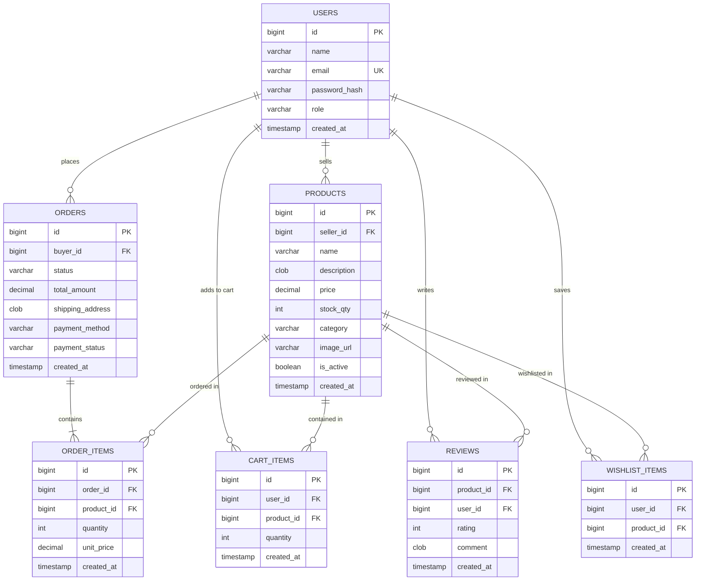
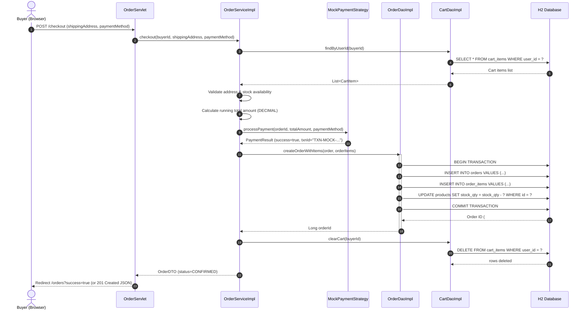

# KathiravanMart — Final Project Engineering Report (FINAL_REPORT.md)

**Course**: Anna University R2025, Semester 3  
**Project**: KathiravanMart — Multi-Seller E-Commerce Marketplace  
**Author / Builder**: Kathiravan (Solo Builder)  
**Target Platform**: Java Servlets, Apache Tomcat 9.0.x, H2 Database  

---

## 1. System Architecture & Overview

KathiravanMart adopts a **Layered Model-View-Controller (MVC)** architecture over standard Java Servlets with a central filter pipeline and clean separation of concerns:
- **Presentation Layer**: Dynamic JavaServer Pages (JSP) using JSTL tags and vanilla JavaScript with `fetch()` for asynchronous JSON endpoints.
- **Filter Layer**: Chain of specialized filters intercepting every request:
  - `RequestIdFilter`: Generates a unique request UUID attached to SLF4J MDC and HTTP response headers.
  - `EncodingFilter`: Enforces UTF-8 character encoding on all request/response bodies.
  - `CorsFilter`: Sets standard CORS headers for cross-origin JSON consumers.
  - `AuthFilter`: Enforces session authentication and role-based authorization (Buyer, Seller, Admin).
- **Controller Layer (Servlets)**: Thin orchestration layer mapping HTTP requests to service calls, deserializing JSON bodies, and forwarding to JSP views or dispatching JSON responses. No SQL or core business logic exists in servlets.
- **Service Layer**: Encapsulates business validation, transaction boundaries, pricing logic, stock management, and AI provider selection.
- **Data Access Object (DAO) Layer**: Abstract interfaces with concrete JDBC implementations. All database queries exclusively use `PreparedStatement` with try-with-resources.
- **Connection Pool**: HikariCP managed by a single `ServletContextListener` (`AppContextListener`).
- **Database**: H2 Relational Database operating in server mode or embedded auto-server mode.

---

## 2. Mandatory System Design Diagrams (Section 5)

### Diagram D1: Entity-Relationship Diagram (ERD)
Derived from Section 4 Database Design Specification.

---

### Diagram D2: Use Case Diagram
Derived from Section 1 Feature Requirements (F1–F8, O1–O4).

```mermaid
flowchart TD
    subgraph Actors
        Buyer((Buyer))
        Seller((Seller))
        Admin((Admin))
    end

    subgraph Authentication_F1
        UC_Reg[User Registration]
        UC_Login[User Login & Session]
    end

    subgraph Buyer_UseCases
        UC_Browse[F3: Browse & Search Catalog]
        UC_Cart[F4: Manage Cart & Running Total]
        UC_Checkout[F5: Checkout & Mock Payment]
        UC_Orders[F6: View Order History]
        UC_Review[F8: Submit Verified Review]
        UC_Wishlist[O1: Wishlist / Save for Later]
        UC_Chat[O4: Consult AI Assistant]
    end

    subgraph Seller_UseCases
        UC_ManageProd[F2: Create/Edit/Delete Listings]
        UC_SellerOrders[F6: View Incoming Orders]
        UC_StatusUpdate[O2: Progress Order Status]
        UC_SellerDash[O3: View Sales Dashboard]
    end

    subgraph Admin_UseCases
        UC_AdminUsers[F7: View & Manage Users]
        UC_AdminOrders[F7: View All Orders]
        UC_Moderate[F7: Moderate / Remove Listings]
    end

    Buyer --> UC_Reg
    Buyer --> UC_Login
    Buyer --> UC_Browse
    Buyer --> UC_Cart
    Buyer --> UC_Checkout
    Buyer --> UC_Orders
    Buyer --> UC_Review
    Buyer --> UC_Wishlist
    Buyer --> UC_Chat

    Seller --> UC_Reg
    Seller --> UC_Login
    Seller --> UC_ManageProd
    Seller --> UC_SellerOrders
    Seller --> UC_StatusUpdate
    Seller --> UC_SellerDash

    Admin --> UC_Login
    Admin --> UC_AdminUsers
    Admin --> UC_AdminOrders
    Admin --> UC_Moderate
```

---

### Diagram D3: Sequence Diagram (Place-Order Flow)
Derived from Section 2 System Architecture Specification & Section 7 Deliverables.

---

## 3. Design Patterns Applied (Section 12 Documentation)

1. **Data Access Object (DAO) Pattern**: Decouples domain entities and business services from raw SQL queries. Interfaces (`UserDao`, `ProductDao`, `OrderDao`, `ReviewDao`, `CartDao`, `WishlistDao`) provide clean abstraction.
2. **Front Controller / Resource Controller Pattern**: Uniform dispatching across HTTP resources, routing browser page requests and JSON API endpoints cleanly.
3. **Singleton Pattern**: HikariCP connection pool managed as an application-wide singleton by `AppContextListener`.
4. **Factory Pattern**: Implemented in `DaoFactory` and `ChatProviderFactory` for modular dependency injection and swappable components.
5. **Strategy Pattern**: Encapsulated in `PaymentStrategy` and `MockPaymentStrategy`, allowing payment mechanisms to be swapped without modifying checkout logic.
6. **Builder Pattern**: Implemented across complex DTOs (`ProductDTO.Builder`, `OrderDTO.Builder`, `UserResponseDTO.Builder`, `CartItemDTO.Builder`) to guarantee immutable and secure object creation.

---

## 4. Technical Decisions & Tradeoffs

- **H2 Database with Auto-Server Mode**: Allows frictionless single-command local development while maintaining complete SQL compatibility with server mode in production.
- **jBCrypt Password Hashing**: Avoids obsolete hashing (MD5/SHA) and enforces industry-standard salting with cost factor 10.
- **BigDecimal for Monetary Values**: Prevents floating-point representation bugs in currency arithmetic.
- **Server-Side AI Proxy**: Restricts AI interactions to verified marketplace domain queries, protects API keys on the server, and provides instantaneous cached fallback responses.

---

## 5. Known Limitations
- Real credit card acquiring gateways (Stripe/Razorpay) are simulated via mock payment confirmation in accordance with Section 1 scope constraints.
- Real-time WebSockets and live geolocation tracking are excluded as mandated by Section 1 scope constraints.
